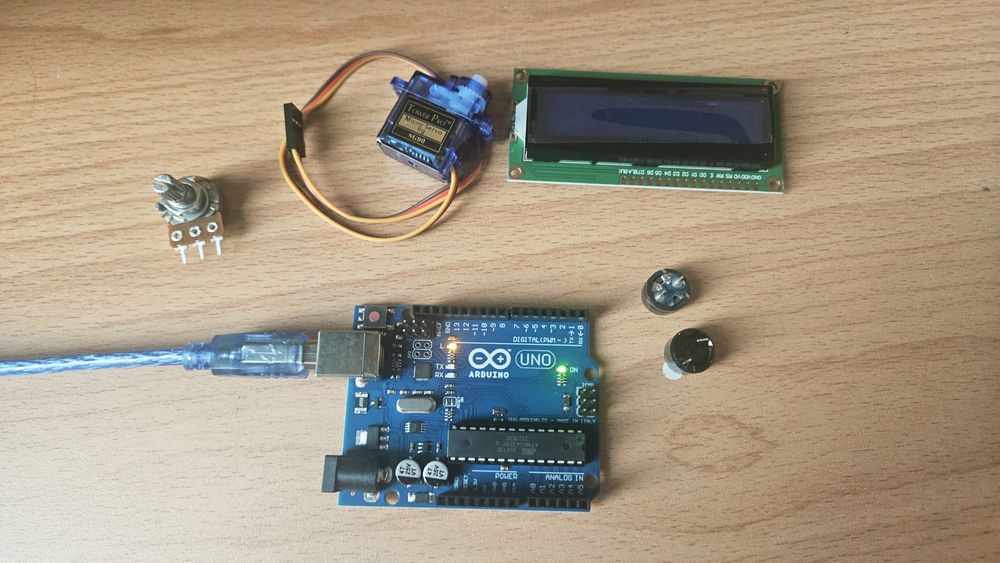

# Task 1: Repository and Arduino verification
- Create the ros-sentinel-loop repository.
- Upload the Arduino Blink example.
- Inventory the available hardware.
- Start the README.
- Photograph the setup.

**Deliverable:** Arduino and repository are working.

## Steps
1. Created the ros-sentinel-loop repository on GitHub.
2. Prepare the README with project description, scope, system overview, serial protocol, and state definitions.
3. Prepare required hardwares: Pentiometer, RGB module, LCD 1602 with IIC, Buzzer, Servo, USB cable, and Arduino Uno R3.
4. Install Arduino IDE and ROS 2 Jazzy
5. Connected Arduino to Arduino IDE.
6. Uploaded the Blink example to verify the Arduino is working. 
   

