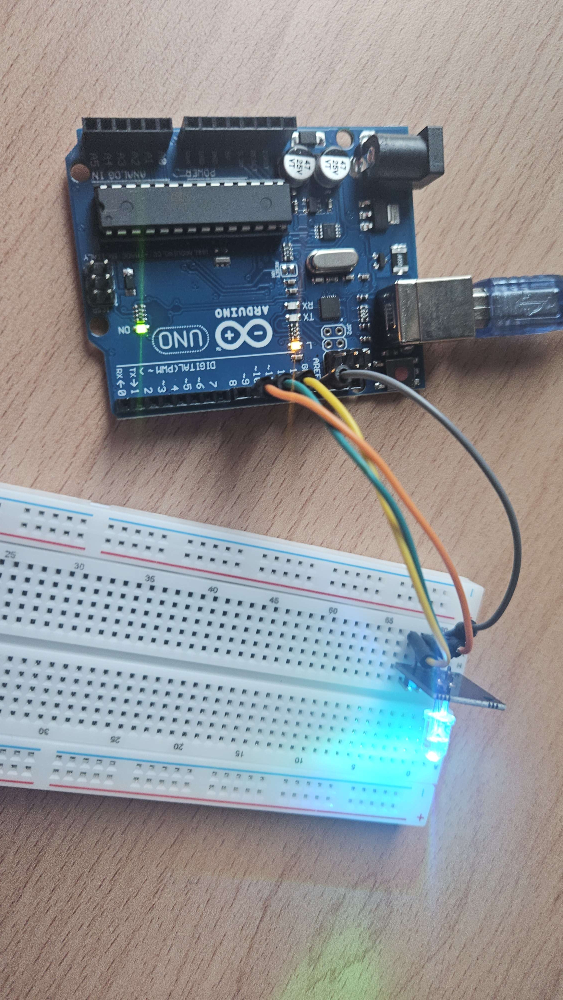

# Task 2: State-output prototype
- Connect the RGB module.
- Implement green, yellow, and red states.
- Test each state using temporary hardcoded commands.
- Use separate LEDs temporarily if necessary.

**Deliverable:** Arduino can display all three states.

## Steps
1. Pre-test: In emulator, test the RGB module with hardcoded commands to display green, yellow, and red states. [Video](../videos/emulator-rgb_test.mov)
2. Proceed to setup in the physical RGB module with Arduino Uno R3. 
3. Hardcode serial state commands in the Arduino code to test each state.