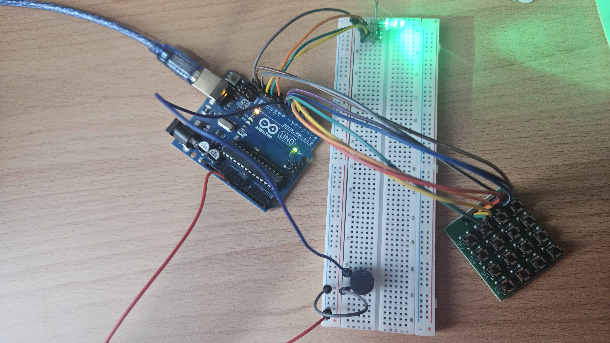

# Task 3: Buzzer and manual fallback
- Connect the buzzer.
- Connect key board.
- Configure the switch using INPUT_PULLUP.
- Trigger red output and buzzer when the button is pressed.

**Deliverable:** Manual fallback works locally.

## Steps

1. Setup buzzer and key board modules to Arduino Uno R3. 
2. Install keypad library in Arduino IDE
3. In the Arduino code, define the buzzer pin and set it as OUTPUT in setup().
4. In the loop(), when the state is FALLBACK, use tone() to activate the buzzer.
5. In the loop(), read the key board input. If the key corresponding to FALLBACK is pressed, set the state to FALLBACK and activate the buzzer.
6. Test the setup by pressing the key for FALLBACK and observing the RGB module turning red and the buzzer sounding.