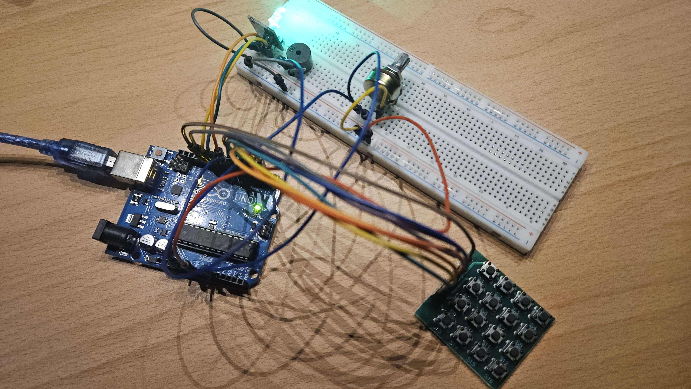
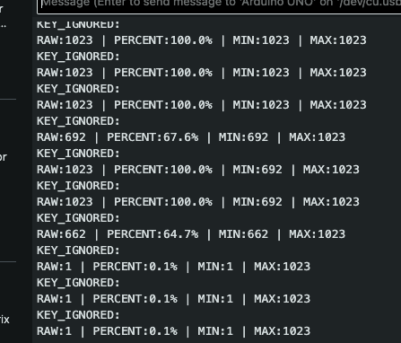

### Task 4: Potentiometer input
- Connect the 10k potentiometer to an analog input.
- Print raw values to the Serial Monitor.
- Convert the value to a percentage.
- Record the observed minimum and maximum.

**Deliverable:** Arduino produces stable simulated sensor readings.

1. Due to limited female-to-male jumper wires, pentiometer is connected to the breadboard and then to Arduino Uno R3. 
2. In the Arduino code, define the potentiometer pin as an analog input.
3. In the loop(), read the potentiometer value using analogRead() and print it to the Serial Monitor.
4. Convert the raw value to a percentage (0-100%) and print it to the Serial Monitor.
5. Observe the minimum and maximum values when the potentiometer is at its lowest and highest positions, respectively.
