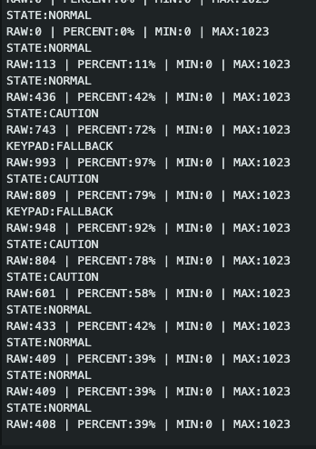

# Task 5: Arduino-only classification
- Implement the initial state thresholds on Arduino.
- Display the state through the RGB module and buzzer.
- Confirm all three ranges.

**Deliverable:** A temporary Arduino-only controller works.

This logic is temporary and is later moved into ROS 2.

## Steps
1. Implement the state thresholds in the Arduino code.
2. Use the potentiometer to test the three ranges:
   - 0–599: NORMAL
   - 600–849: CAUTION
   - 850–1023: FALLBACK
3. Use the RGB module to display the current state:
   - Green for NORMAL
   - Yellow for CAUTION
   - Red for FALLBACK
4. Use the buzzer to provide audio feedback:
   - Off for NORMAL or CAUTION
   - Continuous beep for FALLBACK
  
